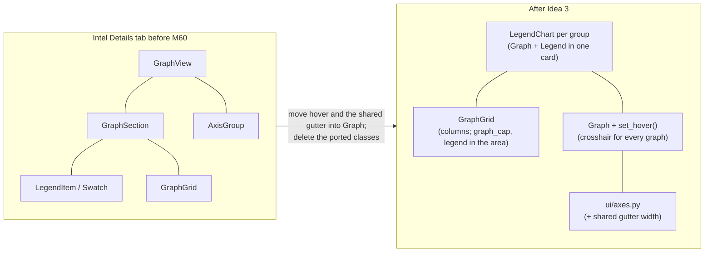

# Idea 3: Intel Details graphs on the shared chart code

Plan: [plan/ideas/idea-03-intel-details-graphs-on-the-shared.md](../../plan/ideas/idea-03-intel-details-graphs-on-the-shared.md)

**Done in Milestone 60** (PLAN.md). Kept here as the record of the
design; [§9.1](../09.1-widgets.md) describes the result. Before it, the Intel *Details* tab drew with the classes
ported from intel_gpu_top_gui (Milestone 9): `GraphView`, `GraphSection`,
`LegendItem`, `Swatch`, `AxisGroup`, and copies of `nice_ceiling`,
`snap_to_device` and the rounded-rectangle helper. Everything else uses
the shared family: `Graph`, `GraphBox`, `Legend`, `LegendChart`,
`ui/axes.py` and the window's `Theme`. Folding the tab into that family:

- **Gained by every graph:** the Intel tab's hover crosshair
  (`Graph.set_hover`) and a shared y-axis gutter, so plots in a column
  line up.
- **Gained by the Intel tab:** palettes and distinct colors from the
  `Theme`, the shared axes, the legend's right-click solo, never-empty
  and compact rules, and the *Graph Time Range* (open question in PLAN:
  its own *History Length* goes; its *Update Interval*, intel_gpu_top's
  sampling rate, stays).
- **Kept in the Intel views** (until M63 moved the grid to `ui/` as
  `ChartGrid`, [§9.1](../09.1-widgets.md)): `GraphGrid`'s column choice, per-GT
  groups, the compact layout, and the header (pause, export, clear).
- **Enforced afterwards:** `test_static` checks that no module outside
  `ui/` defines its own graph drawing area.
