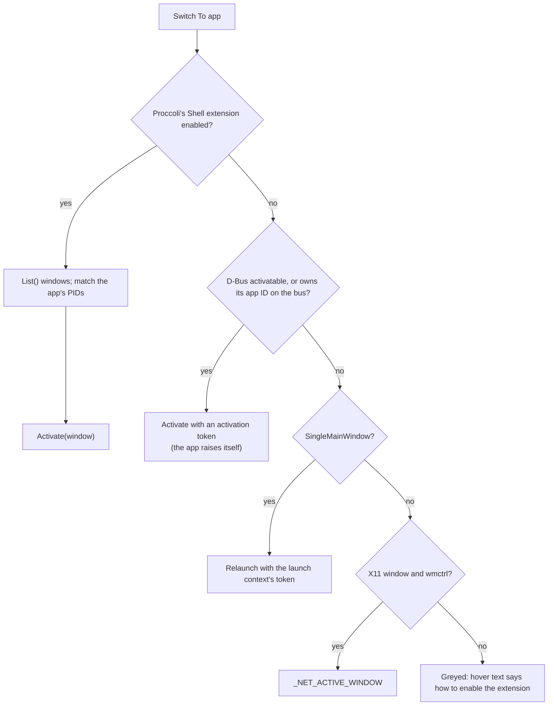

# Idea 5: Switch To any running app

Plan: [plan/ideas/idea-05-switch-to-any-running-app.md](../../plan/ideas/idea-05-switch-to-any-running-app.md)

*Built in Milestone 67 (PLAN.md has the steps). As built:*

- `data/gnome-shell/extensions/proccoli-windows@mamadingleberry.github.io/`
  (installed to `share/gnome-shell/extensions/`, off until turned on):
  an ES-module extension for GNOME Shell 45–50 that exports
  `io.github.mamadingleberry.Proccoli.Windows` at
  `/io/github/mamadingleberry/Proccoli/Windows` on the Shell's session
  connection: `List() → a(tussu)` (window id, pid, app id, title, last
  used) and `Activate(t) → b`. That's all it can do. `tests/test_windows.py`
  checks its XML against `core.windows` and that `gjs` parses it.
- `core/windows.py`: `windows_for(pids, windows, app_id)` (by process, or
  by app ID for helper processes; most recently used first),
  `parse_wmctrl`, `WindowSwitcher.way(app)` / `switch(app,
  launch_context)` (extension → ask the app → X11), `extension_state()`
  (enabled, turned off, needs a log-in, not installed, not GNOME),
  `install(source)` (copies to `~/.local/share/gnome-shell/extensions`
  and adds it to `org.gnome.shell enabled-extensions`, so it starts on at
  the next log-in), `enable()`.
- `System`: `shell_windows`, `shell_activate_window`,
  `shell_extension_info`, `enable_shell_extension`,
  `enable_extension_at_login`, `install_user_extension`,
  `bus_name_owned`, `session_type`, `wmctrl_list`, `wmctrl_activate`;
  `activate_app(app_id, launch_context)` puts the activation token in
  `platform-data` and passes the context to relaunches.
- Apps → *Switch To* for every app (a toast with *Set Up…* when nothing
  reaches it); Preferences → General → *Window Switching* shows the state
  with *Install* (from a source checkout) or *Turn On*.

*The design as planned (Idea 5):* GNOME on Wayland doesn't let one app focus another's
window: `org.gnome.Shell.FocusApp` and `Eval` are refused to ordinary
clients (checked on GNOME Shell 50.1), and there is no
`_NET_ACTIVE_WINDOW` outside X11. M32 therefore asks apps to raise
themselves, which only some can. The design adds a `WindowSwitcher`
(behind `System`) that tries, in order:

- The extension (`proccoli-windows@mamadingleberry.github.io`, shipped
  in the `.deb`) exports `List()` and `Activate(id)` on the session bus;
  it can't read window contents or act on anything else. It's opt-in:
  the user enables it once.
- Activation tokens come from `Gdk.Display.get_app_launch_context()`, so
  GNOME's focus-stealing prevention lets the target raise its window.
