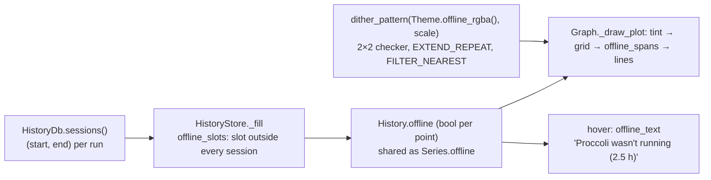

# Idea 10: Shade the time Proccoli wasn't running

Plan: [plan/ideas/idea-10-shade-the-time-proccoli-wasn-t.md](../../plan/ideas/idea-10-shade-the-time-proccoli-wasn-t.md)

*[PLAN.md, Idea 10](../../plan/ideas/idea-10-shade-the-time-proccoli-wasn-t.md). Done as Milestone 68; as built:* the parts of a graph
outside every recorded run get a dithered bar; a missing reading inside
a run stays a plain break.

- Live points are never offline; without the history database nothing
  is. Time before the first recording isn't drawn at all (a graph starts
  where its data does), and a suspend inside a run is a plain break.
- `offline_spans` places the bars with `graph_runs`' index-to-x mapping,
  half a point wider each side; their edges are rounded to device
  pixels, and the pattern has one pixel per device pixel at any scale.
- Every graph draws them, small ones included: they follow the same
  range.
