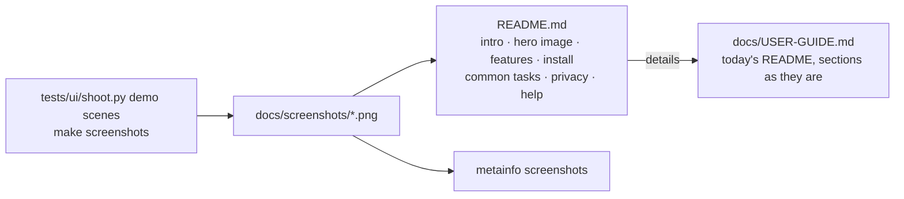

# Idea 11: A shorter, friendlier README

Plan: [plan/ideas/idea-11-a-shorter-friendlier-readme.md](../../plan/ideas/idea-11-a-shorter-friendlier-readme.md)

*[PLAN.md, Idea 11](../../plan/ideas/idea-11-a-shorter-friendlier-readme.md).* The README becomes a short page about common tasks,
with screenshots; today's reference moves to `docs/USER-GUIDE.md`:

- Screenshots come only from demo scenes, so they're reproducible and
  never show the machine's own hardware or processes.
- A static test checks that every image the README links to exists.
