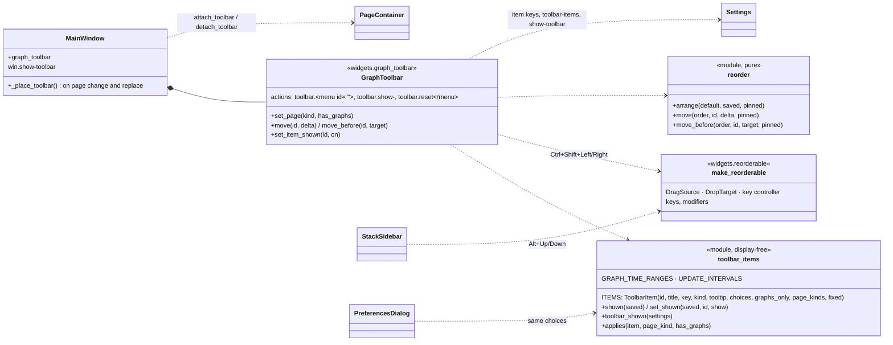

# Idea 12: A graph toolbar

Plan: [plan/ideas/idea-12-a-graph-toolbar.md](../../plan/ideas/idea-12-a-graph-toolbar.md)

*[PLAN.md, Idea 12](../../plan/ideas/idea-12-a-graph-toolbar.md). Done as Milestone 72; as built:* one toolbar per
window, moved under the shown page's header; each item changes the same
setting Preferences does; ordering shared with the sidebar:

- **One toolbar, moved:** `MainWindow._place_toolbar` adds it as a
  second top bar of the shown page's `PageContainer` (its
  `Adw.ToolbarView`) and calls `set_page(kind, page.has_graphs)`. Pages
  say whether they have graphs (`ResourcePage.has_graphs`: device pages
  and the Overview). Graph items hide elsewhere; *Update Interval*
  applies everywhere; *Logical CPUs* only on the Processor page. The bar
  stays on every graph page even when empty, so its ⋮ menu can bring
  items back.
- **Every item has a title above it:** each item is a vertical cell, a
  dim caption (`ToolbarItem.title`) over its control: a menu showing the
  current choice, or a `Gtk.Switch` for a toggle (no text; it slides
  right and takes the accent color when on). The whole cell is the drag
  source.
- **Only view settings, only on pages with charts:** every item is about
  graphs, so the bar hides on Apps and Processes. *Update Interval*
  isn't an item: it sets how often every reading is taken, everywhere,
  not one page's view, so it stays in Preferences (M72.8).
- **Fixed items:** *Logical CPUs* (`fixed=True`, `page_kinds={"cpu"}`) is
  always last on the Processor page and nowhere else; it's not in
  `toolbar-items`, the ⋮ list or the reorder rules. The Processor page's
  own *Show Usages of Logical CPUs* row shows only when
  `toolbar_shown(settings)` is false (*Show Toolbar* off, Lightweight
  Mode), so the page always has exactly one.
- **Settings both ways:** a toggle sets its key on `toggled` and follows
  `connect_changed`; a menu is a stateful string action whose radio
  items carry the nicks. A key fixed by Lightweight Mode
  (`is_pinned`) shows its pinned value greyed out, but Lightweight Mode
  doesn't build the toolbar at all (`Profile.graph_toolbar`).
- **Keys:** Ctrl+Shift+Left/Right move the focused button (Alt+Left/Right
  are Back and Forward). `make_reorderable` matches the modifiers exactly
  (Caps Lock ignored).
- **Narrow windows:** the items scroll sideways (a `Gtk.ScrolledWindow`
  with an external scrollbar) instead of an overflow menu.
- **Room:** the bar is about 65 px tall with its titles; *Show Toolbar* in the main menu
  (`show-toolbar`) gives that back, e.g. on a 768 px screen where the
  Overview's tables would otherwise move below the fold.
