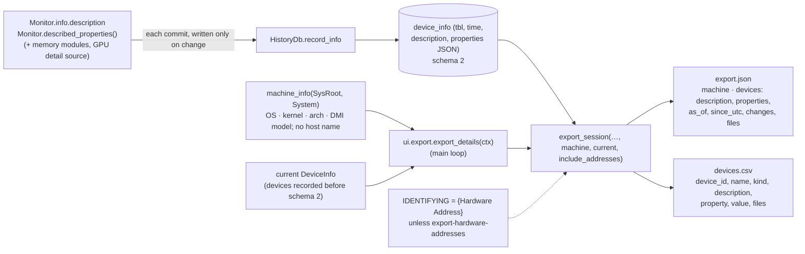

# Idea 14: Exported statistics describe their devices

Plan: [plan/ideas/idea-14-exported-statistics-describe-their-devices.md](../../plan/ideas/idea-14-exported-statistics-describe-their-devices.md)

*[PLAN.md, Idea 14](../../plan/ideas/idea-14-exported-statistics-describe-their-devices.md). Done as Milestone 73; as built:* each device's
description and properties are kept in the history when they change, so
an export of any range can say what the devices were:

- **Rows only on change:** `HistoryStore.commit` calls `record_info` once
  per device per commit; `HistoryDb` keeps the last row per table in
  memory, so an unchanged device costs a JSON dump and a comparison.
- **What changed:** `device_details` reports the details at the end of
  the range, `since_utc`, and `changes` (time, new description, changed
  and removed properties).
- **Schema 2** adds the table on open (`CREATE TABLE IF NOT EXISTS`) and
  raises `meta.schema`; a read-only connection to an older database
  returns no details, and the export falls back to the device as it is
  now (`as_of: "export"`).
- **Privacy:** `ExportPrivacyTest` collects every property key the
  fixture machines produce; a new key fails until it's reviewed as safe
  or added to `IDENTIFYING`. The database itself keeps everything (it's
  private, 0600); only exports leave the identifying ones out.
