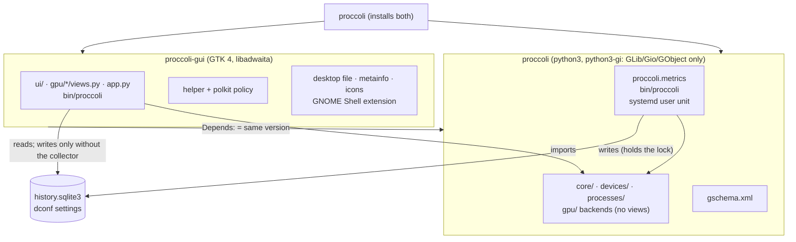

# Idea 15: Separate installs: `proccoli` and `proccoli-gui`

Plan: [plan/ideas/idea-15-separate-installs-proccoli-metrics-and-proccoli.md](../../plan/ideas/idea-15-separate-installs-proccoli-metrics-and-proccoli.md)

*[PLAN.md, Idea 15](../../plan/ideas/idea-15-separate-installs-proccoli-metrics-and-proccoli.md). Done as Milestone 76; as built:* one source tree, split
along the existing layers into two installs (until M83 also a package
that pulled in both; since M83 `proccoli-gui` depends on `proccoli`, and
the recorder's program is `proccoli`, the window's `proccoli-gui`). `packaging/split.py` is the one place that says which file goes
where; `install.sh`, `build-deb.sh` and the static tests all read it:

- **The rule:** nothing in the library imports `ui/`, `app`, Gtk, Gdk or
  Adw at any level; GPU backends reach their views only through the lazy
  import in `create_views`. A static test enforces it, and the file
  lists are generated from it.
- **The interface between the two** is the database (schema version in
  `meta`) and the settings, never Python calls; the versions move in
  lockstep, and a collector that finds a newer schema stops writing.
- **Upgrades:** `proccoli` (0.4.0, one package) becomes the package that
  installs both; `Replaces: proccoli (<= version)` and `Breaks: proccoli
  (<< version)` on the two real packages hand its files over (`<=`
  because the version hasn't moved since 0.4.0).
- **Install script:** `install.sh --metrics`, `--gui` or both (the
  default); the GUI part refuses to install without the metrics part, and
  the metrics part to uninstall while the GUI is there.
- **Removal:** `proccoli`' `prerm` stops each logged-in user's
  collector (`systemctl --user -M user@ stop`); histories stay.
- **Checks:** `InstallSplitTest` (the library never imports the GUI at
  any level; every file in exactly one part); the metrics part installed
  alone runs with Gtk, Gdk and Adw blocked; the debs' fields, contents and
  `prerm`.
