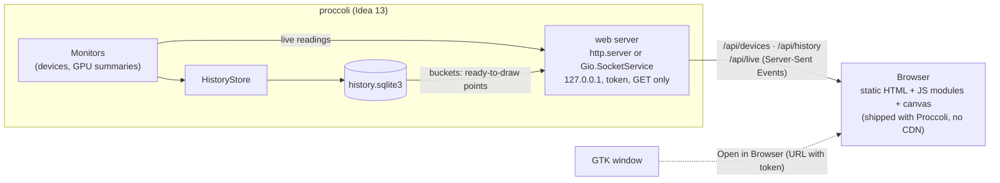

# Idea 16: A Web GUI, hosted locally (brainstorm)

Plan: [plan/ideas/idea-16-a-web-gui-hosted-locally.md](../../plan/ideas/idea-16-a-web-gui-hosted-locally.md)

*[PLAN.md, Idea 16](../../plan/ideas/idea-16-a-web-gui-hosted-locally.md).* A browser view served by `proccoli`,
localhost-only by default, read-only, from the same monitors and
database as the GTK window:

- No new dependencies: `http.server` or Gio, `json`, `ssl` later; no
  JavaScript framework or build step.
- Security first: localhost, a per-user token, `Host` checks, no CORS,
  read-only, process names off by default.
