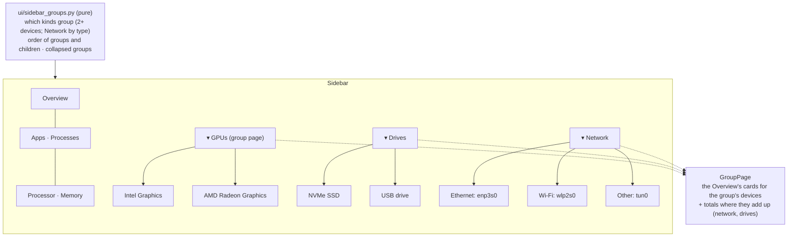

# Idea 18: Overview pages for groups of devices

Plan: [plan/ideas/idea-18-overview-pages-for-groups-of-devices.md](../../plan/ideas/idea-18-overview-pages-for-groups-of-devices.md)

*[PLAN.md, Idea 18](../../plan/ideas/idea-18-overview-pages-for-groups-of-devices.md).* Kinds with several devices get a group entry, a
group page and indented children:

- A kind with one device stays a plain entry, as now.
- Children reorder within their group; groups move as a whole
  (`reorder.py` per list). Collapsed groups are remembered.
- Group pages reuse `OverviewPage`'s cards and planner; totals only where
  summing means something (bytes per second), never for percentages.
