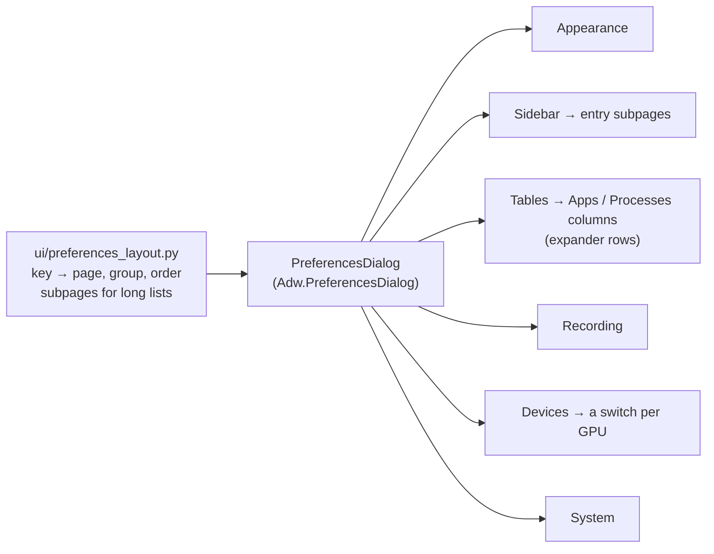

# Idea 20: Preferences in named sections

Plan: [plan/ideas/idea-20-preferences-in-named-sections.md](../../plan/ideas/idea-20-preferences-in-named-sections.md)

*[PLAN.md, Idea 20](../../plan/ideas/idea-20-preferences-in-named-sections.md). Built in M88; [§9](../09-ui-layer.md) describes it as built.* Preferences built from a display-free layout table:
pages, groups and order per settings key, with long lists as subpages.

- Actions and status rows sit in their own group at a page's end.
- A unit test checks every user-facing key appears exactly once.
