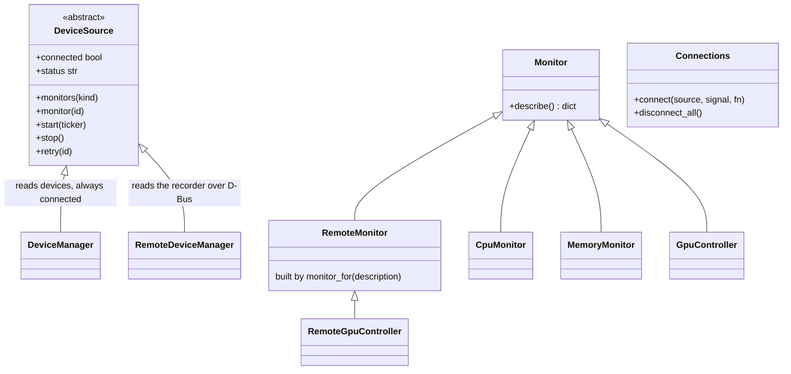

# Idea 21: Refactoring candidates

Plan: [plan/ideas/idea-21-refactoring-candidates.md](../../plan/ideas/idea-21-refactoring-candidates.md)

*[PLAN.md, Idea 21](../../plan/ideas/idea-21-refactoring-candidates.md).* R1–R3 done in M84, as drawn; the rest are still
candidates. The two that changed the shape of the layers:

- `DeviceSource` replaces `hasattr(devices, "connected")` checks.
- `Monitor.describe(encode)` and `Monitor.reading(encode)` keep each
  device's wire format in its own class (`FailedMonitor`, `CpuMonitor`,
  `MemoryMonitor`, `GpuController` add their fields); `metrics_service`
  only asks. `encode` (`snapshot_codec.encode`) is passed in, since the
  codec imports the monitor modules. The window reads them back in
  `devices/remote.py` (`monitor_for`, `RemoteMonitor`,
  `RemoteGpuController`).
- `Connections` (`core/connections.py`): `connect`, `watch` (settings
  keys), `add`/`adopt` (handlers connected elsewhere), `disconnect_all`;
  it replaced the hand-kept handler lists in 17 modules.
